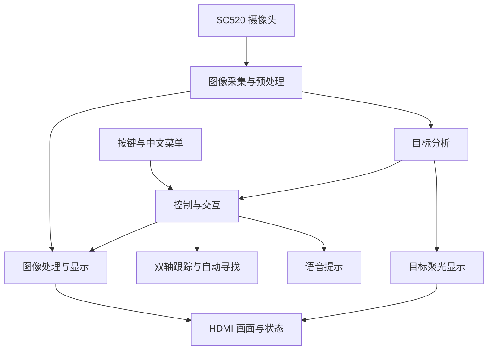

# 可重构实时智能视觉处理系统

**项目已开源，但是所有说明文档未更新。**
再见了所有的嵌赛。

本项目面向嵌入式竞赛 FPGA 赛道·安路二赛道，使用 **PH1P35A 开发板**与 SC520 摄像头，完成图像采集、实时图像处理、目标检测、运动检测、双轴目标跟踪、丢失后的自动寻找及目标聚光显示，并提供中文菜单和运行状态信息。工程与屏幕版本为 **v2.7**。

我们希望把图像处理、目标分析和交互控制放到同一套系统中，让使用者既能看到处理效果，也能直接观察检测结果、调整参数和演示跟踪过程。

> **公开范围说明：本仓库用于竞赛项目展示与说明，不包含核心 RTL、MCU 源码、模型权重、关键算法参数、完整工程、厂商 IP，以及 BIT / BIN / ELF 等烧录或调试文件。仓库内容无法独立编译、烧录或复现完整系统。** 需要补充的评审材料，由参赛团队按组委会要求通过指定渠道提供。详见[公开范围说明](DISCLOSURE.md)。

后续可补充非核心功能文件，但须逐项说明拟公开的内容，并征得项目负责人同意后发布。当前版本仅包含说明文档与文件过滤配置。

## 主要功能

| 功能 | 可以看到什么 |
|---|---|
| 图像采集与显示 | 摄像头图像实时显示在 HDMI 屏幕上 |
| 图像处理 | 对比不同处理效果，并通过菜单调整相关选项 |
| 曝光与白平衡控制 | 观察不同照明条件下的图像，并调整相关设置 |
| 目标检测与识别 | 在画面中查看目标框、类别及相关提示 |
| 运动物体检测 | 观察运动区域及其位置变化 |
| 目标跟踪 | 根据目标偏差调整双轴舵机步长，观察目标框与机构响应 |
| 自动寻找 | 已锁定目标丢失后进行局部双轴扫描，重新确认目标后恢复跟踪 |
| 目标聚光 | 保留目标框内画面，向外渐变压暗背景，突出跟踪目标 |
| 中文菜单与状态显示 | 调整功能开关，查看帧数、帧率、版本及延迟信息 |
| 语音提示 | 配合识别及系统操作提供提示 |

功能入口和演示顺序见[功能介绍](docs/FEATURES.md)。具体效果与拍摄场景、照明和机构布置有关，本仓库不把演示表现写成适用于所有场景的性能保证。

## 硬件与接线

系统使用 **PH1P35A 开发板、SC520 摄像头、HDMI 显示设备与双轴舵机机构**，视频有效画面为 1280 × 720。语音提示通过 HDMI 音频输出，配套素材从板载 TF 接口读取。

水平轴 PWM 接 J1 第 1 针，俯仰轴 PWM 接 J2 第 1 针，均为 3.3 V 逻辑信号；舵机按额定电源供电并与控制端共地。连接器与封装引脚对应说明见[硬件与接线](docs/HARDWARE.md)。

## 板上操作与菜单

SW1 打开或关闭菜单，SW2 隐藏普通菜单等显示内容，SW3 用于原图对比。帧数、帧率、版本及视频延迟保持常驻，智能分析不因显示隐藏而停止。

菜单中 KEY4 向上或增加，KEY3 向下或减小，KEY2 确认，KEY1 返回或取消；关闭全部功能拨码并松开按键后，单独按 KEY4 可复位。菜单分为“图像参数调节、图像效果变换、智能分析”三类。“智能分析 → 目标追踪”包含“自动寻找”和“目标聚光”，两项默认关闭，配合追踪开关使用。完整选项与操作条件见[板上操作与菜单](docs/BOARD_OPERATION.md)。

## 系统结构

下图只说明各部分的职责，不展开内部实现、模型结构和通信协议。



这是功能关系图，各模式的实际处理支路和时序并不由此图定义。更多说明见[系统概览](docs/SYSTEM_OVERVIEW.md)。

## 布局布线结果

当前提交包中的工程报告由 Tang Dynasty 6.2.168116 生成，目标器件为 PH1P35MDG324，placement seed 为 2。以下对应包内 2026 年 11 月 4 日 09:05 的布局布线结果。

| 资源 | 使用量 | 占用率 |
|---|---:|---:|
| Slice | 19,734 / 21,216 | 93.01% |
| ERAM | 90 / 108 | 83.33% |
| DSP | 24 / 40 | 60.00% |

最终建立 WNS 为 **+0.111 ns**，保持 WNS 为 **+0.020 ns**，两项 TNS 均为 0；STA 覆盖率为 **94.25%**。包内 `release` 的 BIT 与该工程构建目录中的 BIT 不同，两者的构建结果需分别引用。详细资源、工具记录与对应关系见[布局布线结果](docs/IMPLEMENTATION.md)。

## 验证情况

既有功能的实板运行由参赛者于 2026 年 11 月 1 日确认。新增功能的更新总结记录了功能正常的用户反馈，并记录菜单乱码在重新加载配套 BIT 后解决。

开发归档保留自动寻找、自适应追踪、渐变聚光和中文菜单的专项检查记录。当前提交包另附 8 类仿真材料，其索引标注为 2026 年 10 月 31 日的旧版检查，不作为新增功能的完整回归证据。开发归档中的渐变聚光和中文界面实板验收仍列为待确认，具体范围见[验证情况说明](docs/VALIDATION.md)。本次文档核对没有重新运行仿真、构建或板端测试。

识别准确率、目标重获成功率、机构速度及长时间稳定性未在本仓库中给出量化结论。演示材料入口见[演示说明](docs/DEMO.md)。

## 演示材料

演示视频已完成拍摄剪辑，仓库尚未提供观看链接或实物照片。现有视频是否覆盖本次新增功能，需要按实际内容说明；后续在[演示说明](docs/DEMO.md)中补充入口和对应场景。

## 仓库目录

```text
README.md                    项目首页
DISCLOSURE.md                公开范围与未公开内容
THIRD_PARTY.md               第三方资料与使用说明
docs/FEATURES.md             功能介绍
docs/SYSTEM_OVERVIEW.md      系统概览
docs/HARDWARE.md             硬件组成与外设接线
docs/BOARD_OPERATION.md      板上操作与完整菜单
docs/IMPLEMENTATION.md       布局布线资源与时序摘要
docs/VALIDATION.md           验证情况与证据来源
docs/DEMO.md                 演示材料说明
docs/SUBMISSION.md           竞赛评审阅读指引
assets/README.md             后续图片的放置说明
```

## 阅读建议

先看本页了解项目，再查看功能、演示与验证情况。完整工程及其他非公开材料是否需要提交、如何提交，以组委会的正式通知为准；本仓库不替代报名系统、正式报告或指定附件。

## 使用说明

本仓库未附加 MIT、Apache 等开源许可证，也不授予未公开工程的使用许可。公开可见不等于完整工程开源。第三方 IP、工具、素材和标识的权属与使用条件见[第三方说明](THIRD_PARTY.md)。
